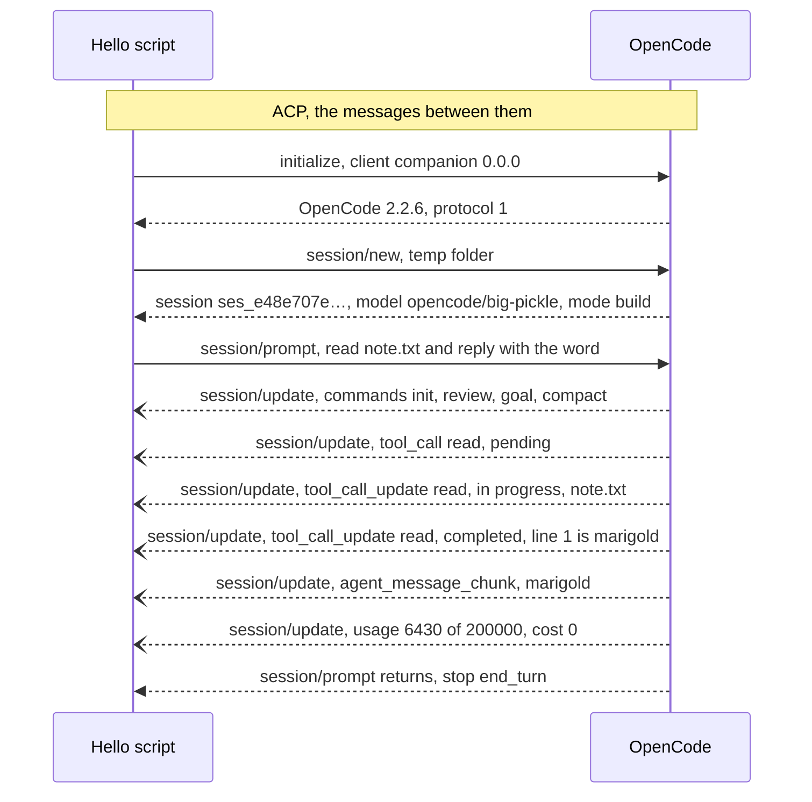

# Phase 1.1

This task runs one real turn with OpenCode and saves what OpenCode sent back. Later tasks copy stored shapes from that file instead of inventing them. The script is `apps/daemon/src/acp-hello.ts`. The product never calls it. Run it again only to refresh the recording.

Two programs talk. The script takes the client role that the daemon will have later. The daemon is our program that hosts the bots. OpenCode is the engine. It runs the model and the tools.

ACP is the message format between them. In the diagram, every arrow is one ACP message. ACP is not a third program.

The script makes a temp folder and writes `note.txt` with the word `marigold`. It then sends three messages. `initialize` says hello. `session/new` starts a session in that folder. `session/prompt` asks OpenCode to read the file and reply with the word. That last message stays open while OpenCode works, and OpenCode sends notes during it. Each note is a `session/update`.



OpenCode 2.2.6 answered on protocol 1. With no login, it picked the model `opencode/big-pickle` and mode `build`. It read `note.txt` with its `read` tool and did not ask permission. The reply was `marigold`, and the turn ended with stop reason `end_turn`.

The script then swaps the temp path for `{workspace}`, writes the file, kills OpenCode, and deletes the folder. Those steps are not ACP messages.

The saved file is `apps/daemon/fixtures/opencode-hello.json`. It stores what OpenCode sent. That is the replies to the three messages, and the notes in `updates`. It does not store what the script sent. The prompt text is not in the file. If OpenCode had asked before using the tool, `permissions` would store that question and the script's answer. This run did not ask, so that list is empty. If OpenCode does ask on a later run, the script allows the call once so the recording can include the result. The approval card is task 1.4.

Tests read this file. They do not start OpenCode.

Record it again from the daemon package.

```sh
pnpm --filter @companion/daemon acp-hello -- --record fixtures/opencode-hello.json
```

`OPENCODE_BIN` picks a different `opencode` program when `opencode` is not on your PATH.
