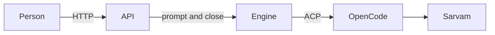
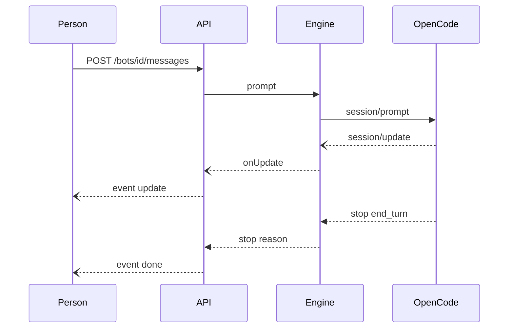

# Phase 2.1

The daemon is the local API for one user's bots. It listens on `127.0.0.1` with no auth. `POST /bots` takes a name and an optional engine (`opencode` by default). It creates one folder, `bots/<id>` next to the database, and one thread row. That row is the conversation: the folder, the session id, and the updates. `GET /bots` lists bots. `GET /bots/:id` returns the bot and its updates. `POST /bots/:id/messages` takes `{ "text" }` and streams server-sent events: `update` with one ACP session update, then `done` with the stop reason. An error after the stream has started is an `error` event. A second message for a bot that is already in a turn is `409`.

A bot is one conversation, and messages are sent to that bot. A tool request is allowed, so a turn can finish a file read.

One OpenCode process stays up for the life of the daemon. The first prompt calls `session/new` and stores the session id. A later prompt on that process reuses it. A session id with no open session in this process is `session/load`.

The turn runs on Sarvam's `glm5.3`. Before OpenCode starts, the daemon writes `opencode.json` into the process config and into the bot's folder. The provider id is `sarvam`, the package is `@opencode/ai/providers/openai-compatible`, and the base URL is `https://api.sarvam.ai/v2`. The model reference is `sarvam/glm5.3`. The key stays in `SARVAM_API_KEY`. The config names that variable twice: as the provider credential, and as the `api-subscription-key` header. The key is not written into the file.

OpenCode 2.2.6 read a word from the bot's `note.txt`, called a tool, and replied with that word. The stop reason was `end_turn`. That check is `apps/daemon/src/api.live.test.ts`. It runs when `COMPANION_LIVE=1`. The scripted tests in `apps/daemon/src/api.test.ts` cover create, the stream, the stored updates, the busy turn, and a failed engine. They do not start OpenCode.

```bash
COMPANION_LIVE=1 pnpm exec vitest run apps/daemon/src/api.live.test.ts
```

`opencode` must be on `PATH`, or set `OPENCODE_BIN`.

## How a message reaches OpenCode

A person talks to the API. The API talks to an engine. The engine talks to OpenCode. OpenCode talks to Sarvam.



`api.ts` is the door. `startDaemon` opens the database, starts the engine, and listens on localhost. `handle` reads the path. `createBot` makes the folder, writes `opencode.json`, and stores the one conversation. `sendMessage` takes the text, calls `engine.prompt`, and writes each update to the client as it arrives. `view` and `transcript` are what the GET routes return. The smaller functions read the body, choose a status code, and write JSON or an event.

The API knows two calls on an engine: `prompt` and `close`. That pair is the `Engine` type. A test can pass its own `prompt`, and the routes still run.

`engine.ts` is how OpenCode fulfills those two calls. `opencodeModelConfig` writes the Sarvam provider file. `startOpencodeEngine` starts `opencode acp`, sends `initialize`, and keeps that process for the life of the daemon. `prompt` asks `openSession` for the conversation, then sends `session/prompt`. Each `session/update` comes back through `onUpdate`. `openSession` reuses a session this process already has, loads one a restart stored, or starts a new one in the bot's folder. `selectModel` points that session at `sarvam/glm5.3` when OpenCode started on another model. `close` stops the process.



Claude and Codex speak ACP too, so they would use the same `prompt` and `close`. Each one still needs its own starter: its program, its config, and how it chooses a model. That is what `engine.ts` does for OpenCode. The routes in `api.ts` stay as they are. A bot record can already name another engine. A message to that bot is refused until that starter exists.
