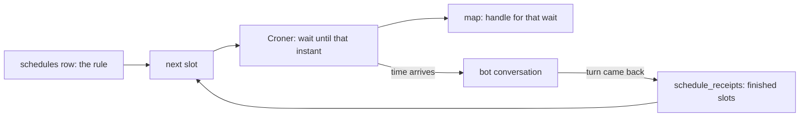

# Phase 2.4

The daemon stores a schedule and sends its prompt into that bot's conversation when a slot arrives. SQLite remembers the rule and the finished slots. Croner only waits. The map holds that wait so it can be stopped or replaced.



SQLite never talks to Croner. The daemon reads the row and creates the timer.

Monday 8:00pm, "every day at 9:00, check the weather," in `Asia/Kolkata`:

- `create` writes one `schedules` row: the bot, the prompt, and `0 9 * * *`. There are no receipts yet.
- The maths names the next slot, Tuesday 9:00:00. `new Cron` waits for that instant. The map stores that wait under the schedule id.
- Tuesday 9:00:00 Croner calls the daemon. The prompt goes to the bot. The transcript keeps the engine's reply. Nothing is written to say a schedule started.
- When the turn comes back, one `schedule_receipts` row is inserted for Tuesday 9:00:00. Every stop reason counts: a normal answer, a denial, a token limit, or a refusal. The map replaces Tuesday's wait with Wednesday 9:00:00.
- The process dies Monday night. The map and the Croner wait die. The row is still there. Startup reads it, computes Tuesday 9:00:00 again, and arms a new wait.
- The process dies Tuesday at 9:05, during the send. No receipt was written. Startup's next slot is Wednesday 9:00:00. Tuesday stays unfinished. Task 2.5 sends that missed slot once if it is still inside the window. While this process stays up, a throw is not tried again.
- A schedule that comes due during a turn waits, then sends that same prompt. Slots that pass during the wait stay unfinished for catch-up.

The next slot is not a column on `schedules`. It is computed from the rule plus the latest receipt. A boolean cannot stand in for receipts: Tuesday being done is not Wednesday being done. The map is not a second copy of the jobs. It is how this process points at the wait Croner created.

A schedule is created on the running daemon. There is no HTTP route yet. `createSchedule`, `listSchedules`, `deleteSchedule`, and `receipts` are what the later tool and UI call. An id is filled in when the caller leaves it out. The bot must already exist. A cron, an interval, and a one-time schedule all wait the same way.

Two behaviors are deferred:

- A person cannot yet send a message while a turn is running. The second message is still refused. The aim, as in Grok Bot, is to accept that message, acknowledge it, and let the other work continue.
- A slot that arrives while a turn is running is not queued beside it. The slot that already fired waits. Later slots that pass are left for catch-up.

The check uses the real clock and a scripted engine. One schedule is a couple of seconds out. The cron and the interval wait for a real minute.

```bash
pnpm exec vitest run apps/daemon/tests/scheduler.test.ts
```
