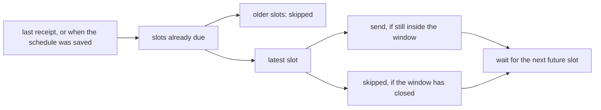

# Phase 2.5

After the daemon was down, or after a turn kept the bot busy, a missed slot is sent once if it is still worth sending. Older missed slots are written down as skipped. The next future slot is what the daemon waits for.

The window is half the gap until the following slot, and it is never shorter than 2 minutes or longer than 2 hours. A one-time slot has no following slot, so its window is 2 minutes.



Monday 8:00pm, "every day at 9:00, check the weather," in `Asia/Kolkata`. The following slot is a day later, half of that is 12 hours, and the clamp makes the window 2 hours.

- The process dies Tuesday at 9:05, during the send. No receipt was written. A start at 10:30 is 90 minutes late, inside the window, so Tuesday is sent once. The receipt says `ran`.
- A start at 12:00 is 3 hours late. Tuesday is `skipped`. The wait is Wednesday 9:00.
- A one-time prompt uses 2 minutes. Three minutes late, it is `skipped` and nothing is sent.
- An hourly schedule that missed 10:00 and 11:00, looked at 20 minutes after 11:00, skips 10:00 and sends 11:00. Half of an hour is 30 minutes, which sits inside the clamp.

A slot that fires while a person is talking waits, then sends when that turn ends. The window does not cancel it: the daemon was up, and the slot already fired. Slots that pass during the wait are decided when that send finishes. The latest one is sent if it is still inside the window. The minutes in between are `skipped`. A thrown prompt writes nothing, so this process does not try it again. The next start decides it, and sends it only when it is still the latest missed slot and still inside the window.

A receipt is the note for one slot. `ran` means the turn came back. `skipped` means the daemon looked at the slot after the window had closed. A stretch of skipped slots is the time the daemon was not firing. The note does not say whether the machine slept or the process was killed. That happened while this process was not running.

Saving a schedule arms the next future slot. Slots from before it was saved are not catch-up. Turning a schedule off without deleting it comes with the schedule CLI.

The check uses the real clock and a scripted engine. A missed slot is stored already in the past, or it is a real minute that passes while a person is mid-turn.

```bash
pnpm exec vitest run apps/daemon/src/scheduler.test.ts apps/daemon/src/thread-store.test.ts
```
