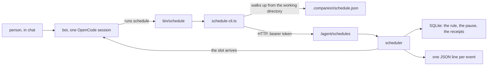

# Phase 2.6

A bot manages its own schedules. The person asks in chat, the bot runs the `schedule` command, and the daemon stores the job. There is no form and no cron field for this. The same command pauses, resumes and deletes.

The command is a small program we ship, not an MCP tool. It needs no tool server from the engine, it costs no tool-schema tokens on each turn, and it can be run by hand. The engine already allows every command, so nothing here adds a permission rule. Real approvals come later.



The daemon is one process, and it starts one `opencode acp` child and keeps that child for as long as it runs. Each bot is its own session inside that child, with its own folder and its own conversation. The chats stay separate. The process does not: every bot's turn goes through the same OpenCode process, so they share its environment variables. A token in the environment would be visible to every bot, which is why the daemon writes `.companion/schedule.json` into the bot's folder instead, with the daemon's address and a secret token. It rewrites that file on every start because the port and the token change. The CLI finds the file by walking up from its working directory, so it still works from a subfolder. The token tells the daemon which bot is calling. The CLI never sends a bot id, and a schedule that belongs to another bot comes back as "unknown schedule".

`POST /agent/schedules` is a request to that same daemon. The daemon listens for HTTP on `127.0.0.1`. The `schedule` command is a short program the bot runs, and that program sends the request. The daemon checks the token, stores the schedule in its own database, and later sends the prompt into the bot's session.

This only separates bots that behave. They share one computer, so a bot that can read files can read another bot's token file. Real isolation comes with the per-user machines.

## Asking for 9:00

Monday evening, "every day at 9, check the weather", and the person is in `Asia/Kolkata`:

1. The bot loads the `schedules` skill. Its text is `apps/daemon/skills/schedules/SKILL.md`, and the daemon copies that folder into OpenCode's config when it starts. The standing rules only point at it. The bot's own `AGENTS.md` is not where schedules live.
2. The skill says to read `MEMORY.md` for a `Timezone:` line. There is none, so the bot asks, the person answers `Asia/Kolkata`, and the bot writes `Timezone: Asia/Kolkata` into `MEMORY.md`. It does not guess.
3. The bot runs `schedule create --prompt "Check the weather in Pune and tell the person if they need an umbrella." --cron "0 9 * * *" --tz Asia/Kolkata`. The prompt is an instruction to itself, because it arrives later as a message in this same conversation.
4. The CLI reads `.companion/schedule.json` and sends `POST /agent/schedules` to the daemon, with the token. The daemon fills in the bot and the id, checks the expression and the timezone, stores the row and arms Tuesday 9:00. The CLI prints one JSON line.
5. The bot runs `schedule list` and tells the person, in their own timezone, what will run and when.
6. Tuesday 9:00 the prompt goes into the conversation. When the turn comes back, the receipt is written. The log shows `created`, `armed`, `fired`, `completed`.

Pausing stops the wait and writes nothing. Slots that pass while it is paused are skipped, not caught up. Resuming waits for the next slot. Deleting removes the row.

## The command

```
schedule create --prompt "text" --cron "0 9 * * *" --tz Asia/Kolkata
schedule create --prompt "text" --every 30m [--tz Asia/Kolkata] [--weekdays mon,fri] [--window 09:00-17:00] [--until 2026-12-31T00:00:00+05:30]
schedule create --prompt "text" --at 2026-11-12T09:00:00+05:30
schedule list
schedule pause <id>
schedule resume <id>
schedule delete <id>
```

`--cron` is five fields and needs `--tz`. `--every` takes `30m`, `2h` or `1d`, and needs `--tz` once days or a window are involved. `--at` is one instant and must carry an offset, so `2026-11-12T09:00:00+05:30` is accepted and `2026-11-12T09:00:00` is rejected. Output is one JSON line, `{"ok": true, ...}` or `{"ok": false, "error": "..."}`, and a failure exits non-zero.

The daemon logs each step as one JSON line on its error output, with `scope` set to `schedule`. A paused slot logs `skipped_paused` and a slot that already finished logs `skipped_duplicate`.

## Tests

```bash
pnpm exec vitest run apps/daemon/src/schedule-cli.test.ts
pnpm exec vitest run apps/daemon/src/api.test.ts
COMPANION_LIVE=1 pnpm exec vitest run apps/daemon/src/schedule-cli.live.test.ts
```

The CLI tests cover bad input, a token that does not belong, a schedule id from another bot, a missing daemon, and a one-time schedule that fires. The live test needs `opencode` on `PATH` (or `OPENCODE_BIN`) and `SARVAM_API_KEY`. It asks the bot for a daily 9:00 task, then to pause it and delete it.

OpenCode is started with plain `opencode acp`. Version 1.19 prints its help and exits when `--print-logs` is passed, so the daemon does not pass it. The live test runs on `sarvam/sarvam-105b`, which is the id OpenCode 1.19 lists for Sarvam. The shim runs the CLI with `node`, which runs TypeScript directly, so packaging the daemon later has to revisit that.
