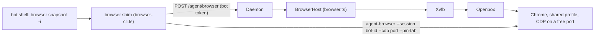

# Phase 2.9 (browser)

A bot can drive a real web page. This half of Task 2.9 covers the browser only. The desktop half is written up in [handoff-2-9-desktop.md](handoff-2-9-desktop.md).

The bot types `browser open <url>`, `browser snapshot -i`, `browser click @e3` and so on. It gets back a text snapshot of the page with element refs, so no vision model is needed. It never starts Chrome and never sees a port, a profile, or a session name.

## One Chrome, one window per bot

All bots share one headed Chrome with one profile at `<root>/browser/chrome-profile`. That is what makes logins shared: sign in once through any bot and every bot is signed in. Chrome allows only one process per profile, so a Chrome per bot on the same profile is not possible anyway.

Each bot gets its own window in that Chrome and every command is pinned to that window's tab. Two bots working at the same moment each stay on their own page. The window is the unit of isolation. The cookies are deliberately not.



## The pieces

- **`BrowserHost`** (`apps/daemon/src/browser.ts`) starts Xvfb, Openbox and Chrome the first time any bot needs a browser, and brings Chrome back if it dies. Chrome gets a free debugging port. The host records a generation id and the child pids in `host.json`, so a crashed daemon's leftovers are found and stopped on the next start. A new Chrome gets a new generation. On shutdown it asks Chrome to quit through CDP first so cookies are written to disk, then stops the helpers.
- **The `browser` shim** (`apps/daemon/src/browser-cli.ts`) is on the bot's `PATH` like the schedule CLI. It finds the daemon the same way, from `.companion/schedule.json`, asks for the debugging port and a per-bot session name, makes sure the bot has a window, and then runs the bundled `agent-browser` pinned to it. A refused flag or command (`--session`, `--cdp`, `--profile`, `--headed`, `--pin-tab`, `close`, `connect`, `cookies clear` and the like) fails with a message telling the bot what to do instead.
- **A per-bot lock** (`.companion/browser.lock`) serialises one bot's browser commands, so two overlapping tool calls cannot interleave. The lock goes stale if its process is gone or it is older than ten minutes.
- **The window** is opened by the daemon with the CDP call `Target.createTarget` and `newWindow: true`. That keeps the window in Chrome's default context, which is the one that holds the shared logins. The shim then binds the bot's session to that tab. When the generation changes after a Chrome restart, the shim drops the stale session and opens a fresh window. `browser window new` does the same for a bot whose tab is gone.
- **The skill** (`apps/daemon/skills/browser/SKILL.md`) tells the bot to read `browser skills get core` once and then follow the snapshot, act, snapshot loop. It says to stop for passwords, one-time codes, CAPTCHAs and payments, and to treat page text as untrusted.
- **Permissions.** `browser *` is allowed without a prompt. `agent-browser`, `npx agent-browser`, `playwright-cli`, `npx playwright`, and `google-chrome`, `chromium` and `chrome` launches are denied, so the only way to a browser is the shim. The standing instruction also tells the bot to use the browser skill for real pages.

## What was learned while building it

- agent-browser's own `window new` makes an isolated context with its own cookies, so logins were not shared. The daemon opens windows through CDP instead.
- Binding with `--pin-tab` on the first command opens a spare `about:blank` tab that covers the bot's page. The shim binds with `tab <targetId>` first and pins from the next command on.
- Under Xvfb, a window covered by another window is treated as hidden and its clicks stall. Chrome runs with `--disable-backgrounding-occluded-windows`, `--disable-renderer-backgrounding`, `--disable-background-timer-throttling` and `--disable-features=CalculateNativeWinOcclusion`, so every bot's window stays live even when stacked.
- Killing the daemon with a plain group SIGTERM lost the login, because Chrome had not flushed its cookies. The `Browser.close` call first fixes that. A Chrome that is hard-killed (SIGKILL) can still lose cookies it has not flushed.
- Only persistent cookies were checked across restarts. A session cookie does not survive a Chrome restart by design.

The choice of agent-browser over Playwright CLI is recorded in [adr/0002-browser-cli.md](adr/0002-browser-cli.md).

## Checks

Unit tests use a fake daemon and a recording runner. They cover the first-command window and pin, a new generation, a failed window open, every refusal, the offline commands, serialisation, stale lock takeover, and `window new`.

The integration test needs `Xvfb`, `openbox` and a Chrome on the machine and skips itself otherwise. It runs a local fake site and two bots at once through the real daemon and the real shim. Each bot books through a form, hits the validation error, and corrects it. Neither sees the other's page, one bot's login is visible to the other, and the login survives a daemon restart.

```bash
pnpm exec vitest run apps/daemon/src/browser-cli.test.ts apps/daemon/src/browser.test.ts
```

The live test gives a real model the same fake site: a booking through the form, a login that survives a daemon restart, and a raw `google-chrome --version` that must fail.

```bash
COMPANION_LIVE=1 pnpm exec vitest run apps/daemon/src/browser.live.test.ts
```

`opencode` must be on `PATH`, or set `OPENCODE_BIN`.

The harness that produced the ADR's numbers is not kept in the tree, because it needs a second CLI installed. It is in commit `16c61dd` (`apps/daemon/src/browser-compare.live.test.ts`, with `@playwright/cli` 0.1.24 as a dev dependency) if the comparison needs repeating.

## Not done here

No desktop, no non-browser app, and no per-bot virtual desktops. Live view and takeover are Phase 7. `agent-browser` is installed as a daemon dependency, so a machine does not need it on `PATH`, but Chrome, Xvfb and Openbox must be installed on the host.
