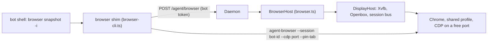
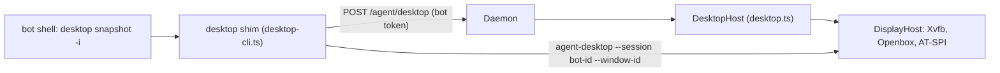

# Phase 2.9

A bot can drive a web page, and it can drive an application that is not a web page. Both happen on one virtual screen. The machine has no monitor, so the daemon starts that screen the first time either one is needed.

## The screen

Two small programs fill the gap, and everything else draws on top of them.

- **Xvfb** is a virtual screen. It draws into memory, so a headed program can run on a machine with no monitor. Headed matters: sites behave differently when they detect headless Chrome, and a person can later watch or take over the same screen (Phase 7).
- **Openbox** is a light window manager. Without one, nothing manages focus, stacking or window placement. A fixed manager keeps that the same on every machine.

`DisplayHost` (`apps/daemon/src/display.ts`) starts them, plus a session bus and the accessibility bus. Chrome and desktop apps both use that screen. A crashed daemon's leftovers are stopped on the next start.

## Browser

The browser CLI is [agent-browser](https://github.com/vercel-labs/agent-browser), a runtime dependency of the daemon, behind our own `browser` command. [Playwright CLI](https://playwright.dev/agent-cli/introduction) was compared and rejected, and it is not installed or used. See [adr/0002-browser-cli.md](adr/0002-browser-cli.md).

The bot types `browser open <url>`, `browser snapshot -i`, `browser click @e3` and so on. It gets back a text snapshot of the page with element refs, so no vision model is needed. It never starts Chrome and never sees a port, a profile, or a session name.

### One Chrome, one window per bot

All bots share one headed Chrome with one profile at `<root>/browser/chrome-profile`. That is what makes logins shared: sign in once through any bot and every bot is signed in. Chrome allows only one process per profile, so a Chrome per bot on the same profile is not possible anyway.

Each bot gets its own window in that Chrome and every command is pinned to that window's tab. Two bots working at the same moment each stay on their own page. The window is the unit of isolation. The cookies are deliberately not.

`BrowserHost` (`apps/daemon/src/browser.ts`) starts Chrome on the shared display the first time any bot needs a browser, and brings Chrome back if it dies. Chrome gets a free debugging port. The host records a generation id and Chrome's pid, so a crashed daemon's Chrome is found and stopped on the next start. A new Chrome gets a new generation. On shutdown it asks Chrome to quit through its debugging port first, so cookies are written to disk. A hard kill can still lose cookies that have not been flushed. The display stays up until the daemon stops it.

The daemon opens each window itself, with the debugging call `Target.createTarget` and `newWindow: true`. That keeps the window in Chrome's default context, which is the one that holds the shared logins. agent-browser's own `window new` would make an isolated context with its own cookies. The shim then binds the bot's session to that tab. Binding with `--pin-tab` on the first command opens a spare blank tab that covers the bot's page, so the shim binds with the tab id first and pins from the next command on. When Chrome restarts, the shim drops the stale session and opens a fresh window.

Under Xvfb, a window covered by another window is treated as hidden and its clicks stall. Chrome runs with the flags that keep every window live even when stacked: `--disable-backgrounding-occluded-windows`, `--disable-renderer-backgrounding`, `--disable-background-timer-throttling` and `--disable-features=CalculateNativeWinOcclusion`.

The `browser` shim (`apps/daemon/src/browser-cli.ts`) is on the bot's `PATH`. It finds the daemon from `.companion/schedule.json`, asks for the debugging port and a per-bot session name, makes sure the bot has a window, and then runs the bundled agent-browser pinned to it. A refused flag or command (`--session`, `--cdp`, `--profile`, `--headed`, `--pin-tab`, `close`, `connect`, `cookies clear` and the like) fails with a message telling the bot what to do instead. A per-bot lock serialises one bot's browser commands, so two overlapping tool calls cannot interleave. The lock goes stale if its process is gone or it is older than ten minutes.

The skill (`apps/daemon/skills/browser/SKILL.md`) tells the bot to read `browser skills get core` once and then follow the snapshot, act, snapshot loop. It says to stop for passwords, one-time codes, CAPTCHAs and payments, and to treat page text as untrusted.

`browser *` is allowed without a prompt. `agent-browser`, Playwright, and launching Chrome or Chromium are denied, so the only way to a browser is the shim.

## Desktop

The desktop CLI is [agent-desktop](https://github.com/vercel-labs/agent-desktop) 1.2.0, a runtime dependency of the daemon, behind our own `desktop` command. The bot gets an accessibility snapshot with element refs, so the common path needs no vision model. A screenshot is the fallback, and the bot asks the vision subagent from Task 2.10 to read it. `xdotool` plus screenshots was compared and rejected. See [adr/0003-desktop-cli.md](adr/0003-desktop-cli.md).

The bot types `desktop launch mousepad notes.txt`, `desktop snapshot -i --compact`, `desktop set-value @e1 "hello"` and `desktop click @e3`. It never sees the display number, and it cannot start an arbitrary program.

### One screen, one lock

Every bot shares the screen Chrome already uses. A desktop command does not start a second display, and a browser command does not take the desktop lock, because browser commands go through Chrome's debugging port rather than the pointer.

The desktop has one keyboard focus and one pointer. One lock, held by the `desktop` command for the whole screen, means two bots act one after the other. Every snapshot is pinned to a window that bot opened, and a ref action only works for a ref from that bot's own snapshot. Separate virtual desktops per bot would change what a screenshot shows, and they would not give each bot its own keyboard, so the lock would still be required.

`desktop launch` starts an app from a short list and nothing else. A free command would be a shell under another name. Each launch is its own process, recorded against that bot, so closing one bot's window does not close another's.

- `mousepad` is a text editor. A file argument has to stay inside the bot's folder. It is started with `--disable-server` and its own settings directory. Without that, every window is the same process, and a crashed editor asks to restore a session.
- `galculator` is a calculator. It takes no file.

A file manager such as Thunar is not on the list. A second Thunar window opens inside the first process, so one bot would own the other's files. The same is true of most single-instance applications. An app is added only when a second launch is a second process, and when the accessibility tree can see its window.

The clipboard is available (`clipboard-get`, `clipboard-set`, `clipboard-clear`). There is one clipboard for the whole screen, so a bot can read what another bot copied. The skill tells the bot not to leave a password or a code on it.

`double-click`, `drag`, `hover` and the mouse commands are refused. They move the pointer, which every bot shares. `click`, `press` and `set-value` act on a ref and do not.

`DesktopHost` (`apps/daemon/src/desktop.ts`) starts and stops those apps. It does not start Chrome. The daemon kills a bot's apps on `desktop close` and when the daemon stops, and stops a crashed daemon's leftovers on the next start.

The `desktop` shim (`apps/daemon/src/desktop-cli.ts`) is on the bot's `PATH`. It takes the shared lock, asks the daemon which windows belong to this bot, and runs the bundled agent-desktop with that bot's session. A refused flag or command (`--headed`, `--session`, `--screen`, and the pointer commands) fails with a message telling the bot what to do instead. Ref actions such as `click` do not take `--window-id`; the ref already names the element. On Openbox, a screenshot of a covered window fails, so the shim raises the bot's window first, while it holds the lock.

GTK apps appear on the accessibility bus once the session bus and `at-spi-bus-launcher` are up. An app that starts before the bus does not appear until it is started again.

The skill (`apps/daemon/skills/desktop/SKILL.md`) tells the bot to read `desktop skills get desktop` once and then follow the snapshot, act, snapshot loop. A screenshot is saved as a PNG and the bot asks the vision subagent to read it. Web pages stay on `browser`.

`desktop *` is allowed without a prompt. `agent-desktop`, `xdotool`, `wmctrl` and `scrot` are denied, including a `DISPLAY=` or `env` prefix, because the match is on the command text.

## On the machine

`agent-browser` and `agent-desktop` are daemon dependencies, so a machine does not need them on `PATH`. agent-desktop's install script has to be allowed to run, or the package falls back to a Node launcher. The machine itself needs Chrome, Xvfb, Openbox, dbus, `at-spi2-core`, mousepad and galculator.
