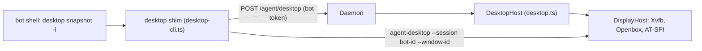

# Phase 2.9b (desktop)

A bot can drive an application that is not a web page. The browser half is [phase-2-9.md](phase-2-9.md).

**Decision:** the desktop CLI is [agent-desktop](https://github.com/vercel-labs/agent-desktop) 1.2.0, a runtime dependency of the daemon, behind our own `desktop` command. The bot gets an accessibility snapshot with element refs, so the common path needs no vision model. A screenshot is the fallback, and the bot asks the vision subagent from Task 2.10 to read it. `xdotool` plus screenshots was compared and rejected. See [adr/0003-desktop-cli.md](adr/0003-desktop-cli.md).

The bot types `desktop launch form`, `desktop snapshot -i --compact`, `desktop set-value @e1 "Priya"` and `desktop click @e3`. It never sees the display number, and it cannot start an arbitrary program.

## One screen, one lock

Every bot shares the screen Task 2.9a already starts: Xvfb, Openbox, a session bus and the accessibility bus. Chrome stays on that screen. A desktop command does not start a second display, and a browser command does not take the desktop lock, because browser commands go through Chrome's debugging port rather than the pointer.

The desktop has one keyboard focus and one pointer. One lock, held by the `desktop` command for the whole screen, means two bots act one after the other. Every snapshot is pinned to a window that bot opened, and a ref action only works for a ref from that bot's own snapshot. Per-bot virtual desktops were tried as an idea and not used: they change what a screenshot shows, and they do not give each bot its own keyboard, so the lock would still be required.



## What a bot can start

`desktop launch` starts an app from a short list and nothing else. A free command would be a shell under another name.

- `form` is a small GTK window shipped with the daemon: a name, a terms box and a Submit button. Submit does nothing useful until the terms are accepted and a name is entered. The window then shows a confirmation code.
- `mousepad` is a text editor. A file argument has to stay inside the bot's folder. Each launch is its own process, with its own settings, so one bot's editor is not the other's.

The daemon records the process against that bot, kills it on `desktop close` and when the daemon stops, and stops a crashed daemon's leftovers on the next start.

## The pieces

- **`DisplayHost`** (`apps/daemon/src/display.ts`) starts Xvfb, Openbox, a session bus and the accessibility bus the first time anything needs the screen. Chrome and desktop apps both use it. A crashed daemon's leftovers are stopped on the next start.
- **`DesktopHost`** (`apps/daemon/src/desktop.ts`) starts and stops the allow-listed apps on that screen. It does not start Chrome.
- **The `desktop` shim** (`apps/daemon/src/desktop-cli.ts`) is on the bot's `PATH`. It takes the shared lock, asks the daemon which windows belong to this bot, and runs the bundled `agent-desktop` with that bot's session. A refused flag or command (`--headed`, `--session`, `--screen`, `clipboard-get`, `launch`, and the pointer commands) fails with a message telling the bot what to do instead. Ref actions such as `click` do not take `--window-id`; the ref already names the element.
- **The skill** (`apps/daemon/skills/desktop/SKILL.md`) tells the bot to read `desktop skills get desktop` once and then follow the snapshot, act, snapshot loop. A screenshot is saved as a PNG and the bot asks the vision subagent to read it. Web pages stay on `browser`.
- **Permissions.** `desktop *` is allowed without a prompt. `agent-desktop`, `xdotool`, `wmctrl` and `scrot` are denied, including a `DISPLAY=` or `env` prefix, because the match is on the command text. The standing instruction tells the bot to use the desktop skill for an application that is not a web page.

## What was learned while building it

- agent-desktop's ref actions go through AT-SPI and do not move the pointer. That is why two bots can share a screen without a virtual desktop each. The lock is still there, because a key, a screenshot of a covered window, and raising a window are global.
- On Openbox, a screenshot of a covered window fails. The shim raises the bot's window first, while it holds the lock.
- GTK apps appear on the accessibility bus once the session bus and `at-spi-bus-launcher` are up. An app that starts before the bus does not appear until it is started again.
- mousepad is one process for every window unless it is started with `--disable-server`. Each bot gets its own process and a fresh config directory, so a crashed editor does not ask to restore a session.
- `click` and `set-value` reject `--window-id`. The snapshot is what carries the window.

## Checks

Unit tests use a fake daemon and a recording runner. They cover the pinned snapshot, a ref action with no window id, launch, a file outside the bot's folder, the refusals, another bot's window, several windows, the screenshot handed to the vision subagent, a filtered window list, the shared lock, and the offline skill command.

The integration test needs `Xvfb`, `openbox`, `dbus-daemon`, the AT-SPI launcher, Python GTK and mousepad, and skips itself otherwise. Two bots fill the form at the same time through the real daemon and the real shim. Each hits the terms error, then gets its own confirmation code, and neither window shows the other's code. A screenshot is a PNG and the command tells the bot to ask the vision subagent. Stopping the daemon stops the apps. A second test kills apps left behind by a host that was not closed.

```bash
pnpm exec vitest run apps/daemon/tests/desktop-cli.test.ts apps/daemon/tests/desktop.test.ts
```

The live test gives a real model the form, then a raw `xdotool` command that must fail.

```bash
COMPANION_LIVE=1 pnpm exec vitest run apps/daemon/tests/desktop.live.test.ts
```

`opencode` must be on `PATH`, or set `OPENCODE_BIN`.

The comparison that produced the ADR's numbers is kept, because both tools are available here: agent-desktop ships with the daemon, and `xdotool` and `scrot` are ordinary programs. It is skipped unless asked for.

```bash
COMPANION_COMPARE=1 pnpm exec vitest run apps/daemon/tests/desktop-compare.live.test.ts
```

## Not done here

Live view and takeover are Phase 7. The allow list is `form` and `mousepad` only. The base image for Task 4.2 needs Xvfb, Openbox, dbus, `at-spi2-core`, Python GTK (`python3-gi` and `gir1.2-gtk-3.0`) and mousepad, on top of Chrome. `agent-desktop` is an npm dependency, and its install script has to be allowed to run so the native binary is linked.
