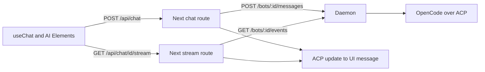
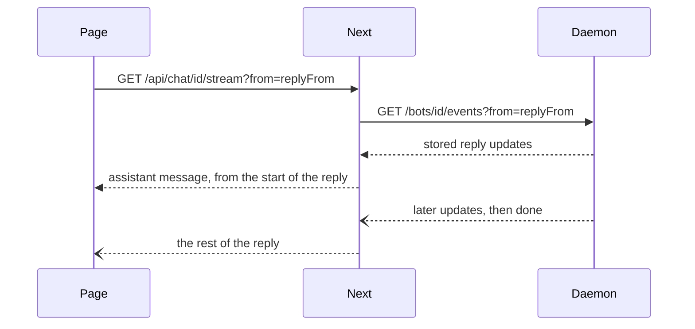

# Phase 3.1

The web app is one chat with the computer's default bot. Opening the page reuses the first bot, or creates one named Companion. The transcript is already there, including the greeting from the bot's first turn. A message streams back as it is written. An image can go with the text. Reloading while a turn is still running continues that reply instead of starting it over.

The browser never talks to the daemon. It talks to two Next.js routes, and those routes talk to the daemon on `COMPANION_DAEMON_URL`. `POST /api/chat` sends the latest message. `GET /api/chat/[id]/stream` rejoins a turn that was already running when the page loaded. Both answer with a server-sent event stream in the AI SDK's UI message format. The daemon still speaks ACP. One converter in the web app is the only place that translates.

```bash
pnpm e2e
COMPANION_LIVE=1 pnpm e2e
```

The first command builds the web app, starts it with a scripted daemon, and runs the Playwright cases. The second uses OpenCode on Sarvam. It needs `opencode` on `PATH` (or `OPENCODE_BIN`) and `SARVAM_API_KEY`. CI runs the scripted cases. The live one stays behind `COMPANION_LIVE=1`, the same gate as the daemon's live tests.

## How a message reaches the page

The person types in the AI Elements prompt. `useChat` posts the message to the Next route. The route turns image file parts into the `{ mimeType, data }` images the daemon already stores, then calls `POST /bots/:id/messages`. The daemon keeps the person's text and images as `user_message_chunk` updates before the turn starts, so a reload can show them. It streams ACP `session/update` notifications, then `done` or `error`. The converter turns those into text, reasoning, dynamic tool parts, and a finish. AI Elements renders them. Streamdown renders the markdown while it is still arriving.

A second message is blocked in the composer while a turn is running. The daemon would answer `409`.



`apps/web/src/lib/messages.ts` is the converter. `transcriptToMessages` reads a stored transcript: the person's chunks, including images, become a user message, and the reply that follows becomes the assistant message. Thought chunks are reasoning. Tool calls are dynamic tool parts, with a failed call shown as an error. Notices are text. Plan, usage, and the other session bookkeeping stay out of the chat. The switch over update kinds is exhaustive.

`createReplyStream` does the same for one live turn. That stream is only the reply. The person's message is already on the page.

`apps/web/src/lib/daemon.ts` is the web app's side of the daemon. `apps/web/src/app/page.tsx` loads the bot. `apps/web/src/components/chat.tsx` is the conversation.

## Reloading mid-turn

The daemon keeps running a turn after the browser leaves, and it remembers where that turn's reply starts. A running turn is `{ status: "running", replyFrom }`. `replyFrom` is the transcript index of the first update that belongs to the reply, after the person's message.

The page builds its messages from `updates.slice(0, replyFrom)`. That includes the person's message and leaves the partial reply out. `useChat` is then asked to resume, and the resume request passes `from=replyFrom`. The stream route reads `GET /bots/:id/events?from=N`, which replays the reply from its first update and then follows it live. The replay arrives as a new assistant message, so the reply appears once.

When nothing is running and there is nothing to replay, the events route answers `204`. The page does not resume.



## What the browser test covers

`e2e/chat.spec.ts` starts the daemon with an engine that answers in two beats. The first beat is visible immediately. The rest waits until the test releases it. That is what makes a reload land in the middle of a turn. The cases send a message and see streamed markdown and a tool call, attach an image and check the daemon stored it, and reload before the turn finishes and then see it finish. `e2e/chat.live.spec.ts` asks OpenCode to reply with one word.
