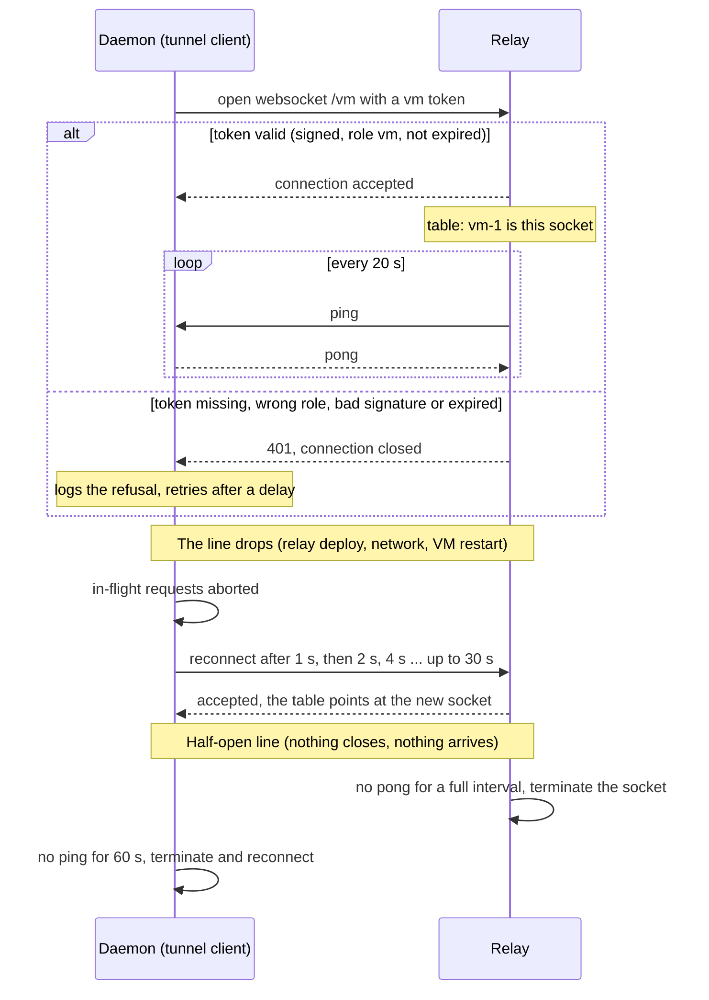
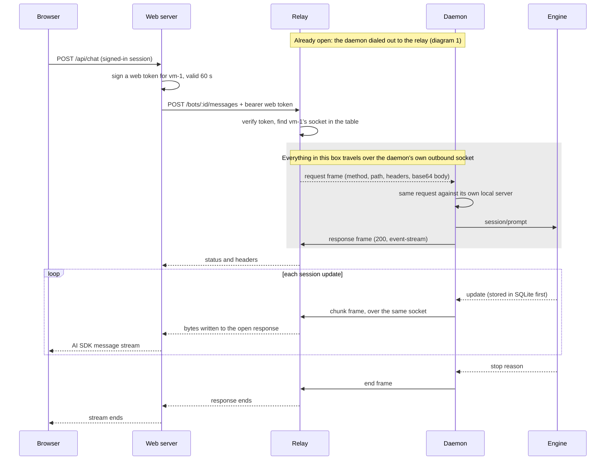
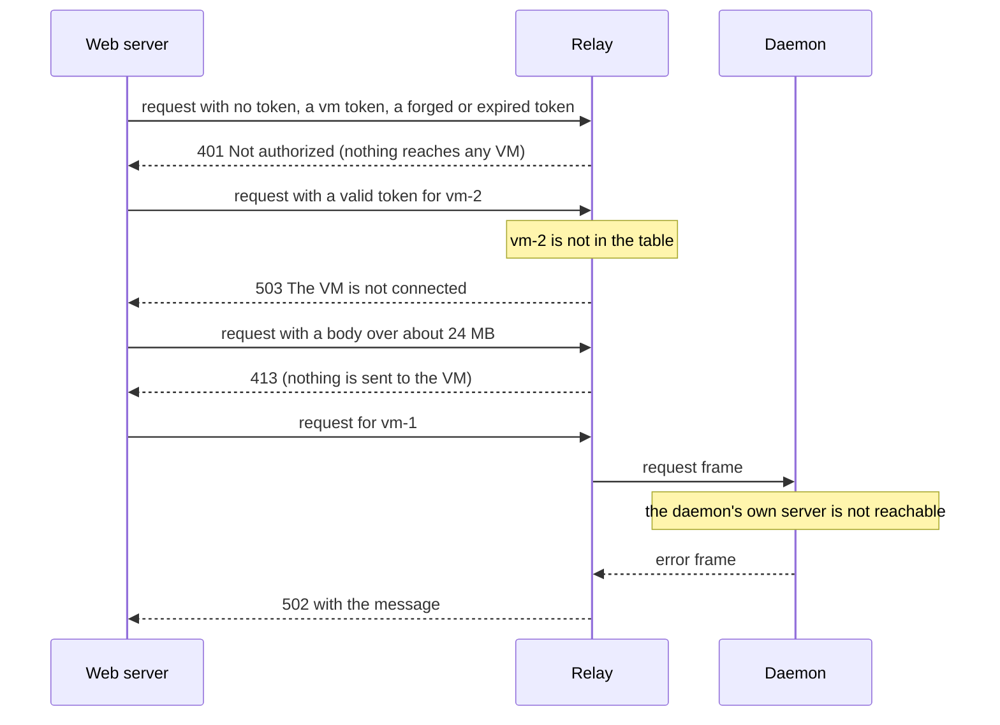
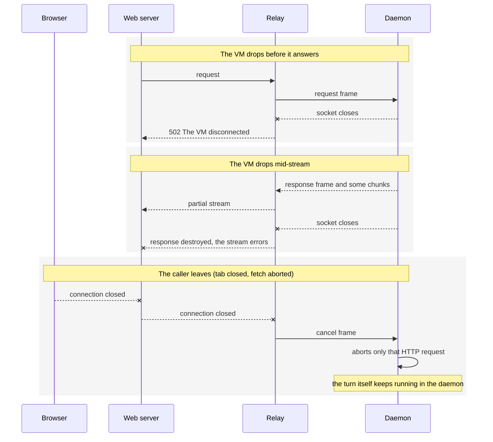
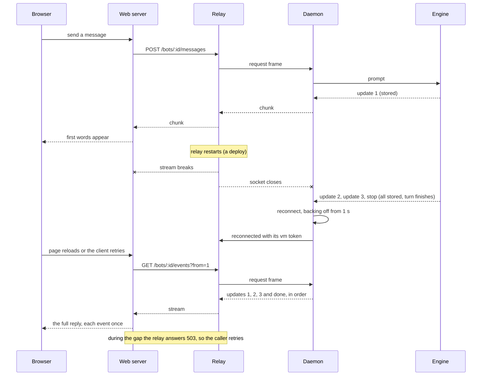
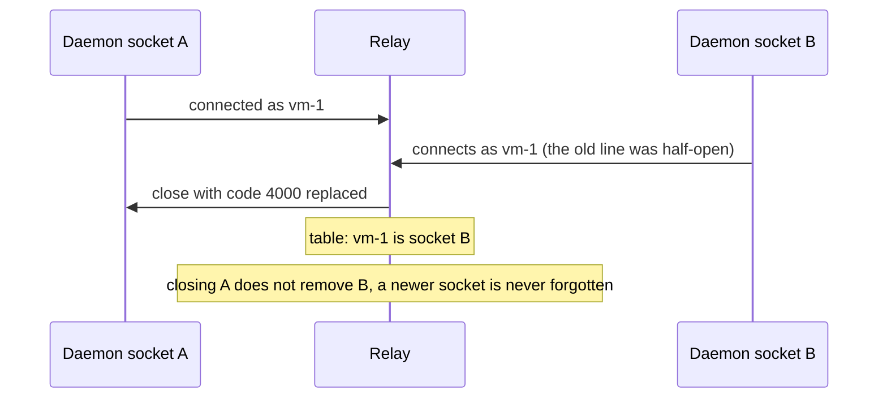

# Phase 4.3: the relay

A user's VM accepts no inbound connections (Task 4.2). So the web server cannot call it the way it calls a daemon on your laptop. The relay turns that around: the VM's daemon dials **out** to a public service and keeps the connection open, and the web server sends its requests to that service, which passes them down the open connection.

```
browser → Next.js (checks the login) → relay ←── opened by the VM's daemon ── daemon → OpenCode
```

## What each piece does

- **`packages/shared/src/tunnel.ts`** is the agreement. A request becomes one `request` frame. The answer comes back as a `response` frame (status and headers), then `chunk` frames as the daemon produces them, then `end`. The daemon's own API is unchanged: the tunnel carries ordinary HTTP, so there is no second API. The file also signs and checks tokens: a `vm` token proves a connection is a given VM, and a `web` token names the VM a request is for. Both are signed with one secret and last a short time.
- **`apps/daemon/src/tunnel.ts`** is the daemon's side. It connects to the relay, makes each forwarded request against its own local server, streams the answer back, stops a request when the relay cancels it, and reconnects with a growing delay (1 s up to 30 s) when the line drops. The relay pings every 20 s. A daemon that hears nothing for 60 s drops the line and reconnects, because a stopped-and-restarted VM can leave a half-open connection that never reports closing. It starts only when `COMPANION_RELAY_URL` is set.
- **`apps/relay`** is the relay. It keeps a table of connected VMs and nothing else: no bodies, no history, no user data. A request with no valid `web` token is 401. A request for a VM that is not connected is 503. If the VM drops before answering, the caller gets 502. If it drops mid-stream, the caller's stream ends with an error. If the caller leaves, the VM is told to stop that request. A second connection for the same VM replaces the first.
- **`apps/web/src/lib/daemon.ts`** picks the route. Every call to the daemon already went through `daemonFetch`, so only that function changed.

A turn belongs to the daemon (Task 2.7). When the relay restarts or a connection drops, the turn keeps running and every update is already stored. The caller rejoins with `GET /bots/:id/events?from=N` and receives what it missed. The relay needs no buffer for this.

## Local mode needs no relay

| Mode                 | Web process                                                           | Daemon                                      |
| -------------------- | --------------------------------------------------------------------- | ------------------------------------------- |
| Local or self-hosted | `COMPANION_DAEMON_URL=http://localhost:3010`                          | nothing extra                               |
| Cloud                | `COMPANION_RELAY_URL`, `COMPANION_RELAY_VM`, `COMPANION_RELAY_SECRET` | `COMPANION_RELAY_URL`, `COMPANION_VM_TOKEN` |

Setting both ways on the web process is refused. A daemon with no `COMPANION_RELAY_URL` opens no outbound connection. Running the image locally is unchanged from `docs/phase-4-2.md`.

Until accounts own VMs (Task 4.4), the web process names one VM through `COMPANION_RELAY_VM`. The token carries no user yet: the relay trusts the web server, which has already checked the login.

## Why Fargate

The relay has to hold long-lived connections: every VM's socket, all day, and every streamed turn. A function service (Lambda, or a hosting platform built on it) runs code per request and stops it after a short time, so it cannot. API Gateway's websockets are capped at 2 hours with a 10-minute idle timeout and 128 KB messages. A plain EC2 machine works but means patching a server. Fargate runs a container image that we hand it: AWS finds the machine, restarts the container if it stops, and there is nothing to patch.

## The AWS stacks (`infra/src/relay.ts`)

They exist only when `COMPANION_RELAY_DOMAIN` is set, so a laptop-only setup needs none of this.

- **`CompanionRelayCert`** asks AWS Certificate Manager for a certificate for the relay's name, proven by DNS.
- **`CompanionRelay`** has its own small network (apart from the VMs'), one Fargate task (0.25 vCPU, 512 MB, arm64) that gets its signing secret from Secrets Manager, and an internet-facing load balancer. The balancer serves HTTPS, redirects HTTP, and has an idle timeout of 3600 s because a streamed turn can be quiet for minutes and VM sockets stay open for days. The task's firewall accepts the balancer and nothing else. There is no NAT gateway.

There is one task on purpose: it holds every VM's connection, so a second would need a shared message bus between them. A deploy starts the new task before stopping the old one, so for a short time two run and a request may reach one the VM has not yet reconnected to (a 503). The caller retries.

The image is built from this repo by `cdk deploy` (Docker must be running), or pulled from a registry when `COMPANION_RELAY_IMAGE_REF` names one pinned by digest.

### Deploy

```bash
export COMPANION_RELAY_DOMAIN=relay.example.com
pnpm --filter @companion/infra exec cdk deploy CompanionRelayCert
```

The certificate stack waits until AWS can see the validation record. In the ACM console, open the pending certificate, copy its CNAME name and value, and add that record at your DNS provider. When the stack finishes:

```bash
pnpm --filter @companion/infra exec cdk deploy CompanionRelay
```

The outputs include `PointDnsAt`. Add a CNAME from the relay's name to it. If the DNS provider is Cloudflare, set the record to **DNS only** (grey cloud): its proxy closes connections that are quiet for 100 seconds, which would cut streamed turns.

The shared secret is generated in AWS and printed nowhere. Read it when needed:

```bash
aws secretsmanager get-secret-value --secret-id <SecretArn output> --query SecretString --output text
```

### Try it by hand

```bash
export RELAY_SECRET=<the secret>
# What the daemon on a VM is given
pnpm --filter @companion/relay -s mint-token vm vm-1 60
# What the web server sends for that VM
pnpm --filter @companion/relay -s mint-token web vm-1 10
```

Run the daemon with `COMPANION_RELAY_URL=wss://relay.example.com` and the first token as `COMPANION_VM_TOKEN`. Then `curl -H "authorization: Bearer <web token>" https://relay.example.com/bots`.

## Limits to know

- `/health` on the relay is the relay's own health check, so the daemon's `/health` is not reachable through it. Any other daemon route is.
- A request body can be about 24 MB (a websocket message is capped at 32 MB, and base64 adds a third). Images are capped at 5 MB each.
- Nothing slows a fast daemon for a slow reader. Chat events are small, so this does not matter yet; live view (Task 7.1) will need it.
- The relay does not wake a stopped VM. That is Task 4.5.

## Sequence diagrams

The parties: the **browser**, the **web server** (Next.js, which checks the login), the **relay**, the **daemon** (its tunnel client plus its own HTTP API), and the **engine** (OpenCode).

### 1. A VM connects, and stays connected



### 2. A turn started from the web, success

The relay never connects to the VM. It writes onto the websocket the daemon opened in diagram 1, so every arrow between the relay and the daemon below travels over that one outbound connection (shown as a dashed box).



### 3. Requests the relay refuses or cannot deliver

As in diagram 2, a frame from the relay to the daemon is written onto the socket the daemon opened. The relay has no other way to reach it.



### 4. Something drops while a request is open



### 5. The relay restarts mid-turn, and the caller catches up

The turn belongs to the daemon, and every update is stored before it is sent. So nothing is lost when the relay goes away. The caller asks for what it has not seen.



### 6. One VM, two connections



## Checks

```bash
pnpm exec vitest run packages/shared/src/tunnel.test.ts apps/relay apps/daemon/tests/tunnel.test.ts apps/daemon/tests/tunnel-relay.test.ts apps/web/tests/daemon.test.ts infra
```

- `apps/relay/tests/relay.test.ts`: only a valid `web` token gets through, a token for one VM never reaches another's connection, a streamed answer comes back whole, a cancelled or dropped request is handled on both sides, and a silent VM is dropped.
- `apps/daemon/tests/tunnel.test.ts`: the daemon answers, streams, stops on cancel, reconnects and stops reconnecting when closed.
- `apps/daemon/tests/tunnel-relay.test.ts`: a real daemon, the real relay and the real tunnel. A turn starts through the relay, the caller leaves, the relay restarts, and the full reply replays once the tunnel is back.
- `infra/tests/stacks.test.ts`: DNS-validated certificate, HTTPS and the redirect, the long idle timeout, the task reachable from the balancer only, the secret passed by reference.

The two container images were also run together on a local Docker network: the daemon image connected to the relay image, a request with a valid token read `/bots` through the tunnel, a missing token was 401, a token for another VM was 503, and restarting the relay container reconnected the daemon within a second.

Not yet checked: the stacks have not been deployed to AWS, and the web chat has not been driven through a real cloud VM. Both need your AWS login and DNS record.
