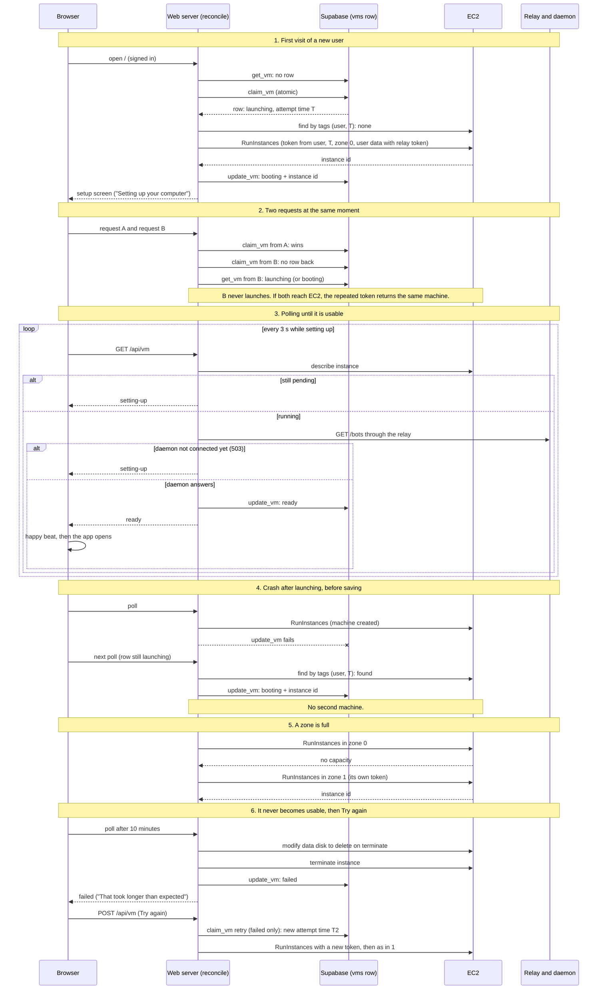

# Phase 4.4: provisioning

A person's first visit now makes them a cloud computer. Nothing is clicked: the home page notices there is none, starts one, and shows a friendly "Setting up your computer" screen until it answers. An existing person with a ready computer goes straight to their bots.

## How it works

One user has exactly one computer, so its record is one row per user in a `vms` table (`supabase/migrations/…_vms.sql`): `state`, `instance_id` and `attempt_started_at`; no row means none was requested. The table has row-level security on with no policies, and the browser roles' privileges on it are revoked. Only the web server reaches it, using the Supabase secret key, which skips row-level security. The browser asks `/api/vm` instead. It is its own table, not part of `profiles`, so profile fields a person may read or edit never share a row with it. The secret key lives only in server code, which never ships to the browser. Each claim is one atomic statement (an insert that loses if a row exists, or an update of a still-failed row), so only one request wins.

`reconcile` in `apps/web/src/lib/vm.ts` is one idempotent step. It reads the row and moves it one step forward: `launching → booting → ready`, or `failed`. Nothing keeps running between calls. The page calls it on each visit, and the setup screen calls it every few seconds through `GET /api/vm`, so a closed browser or a crashed request just leaves the row where it was.

**It never makes two computers.** Three layers, each catching a different failure:

1. The database claims a user atomically, so of several simultaneous requests exactly one launches.
2. EC2 gets a `ClientToken` built from the user id, the attempt's `attempt_started_at` and the zone. Repeating a launch for the same attempt returns the same machine; a new attempt has a new token.
3. Before launching, the machine is looked up by its `companion:user` and `companion:attempt-started` tags, which covers a crash after EC2 answered but before the row was saved.

**Ready** means EC2 says `running` and a request through the relay to that user's daemon succeeds. The relay itself is unchanged and Postgres stays the single record.

**Failure.** An attempt not ready 10 minutes after `attempt_started_at` is marked `failed`, its machine terminated and its data disk released with it (the disk is flagged to delete, because a failed first attempt holds no user data). A full zone is skipped once for the other zone. The setup screen's Try again claims a new attempt.

## How a new machine learns who it is

`RunInstances` passes cloud-init user data that writes `/etc/companion-vm.env` (root-only): the relay address and a relay token for this one VM, valid for a year and counted from the attempt, so a repeated launch sends identical settings. The container starts with `--env-file` on that file, and the daemon deletes `COMPANION_VM_TOKEN` from its own environment right after reading it, so the engine, the browser and bot commands do not inherit it. This is only a partial guard: a bot is the same OS user as the daemon. Moving the tunnel outside the container is tracked in an issue.

## Setup screen

`components/vm-setup.tsx`: a rocket, a cloud and a bunny (not sign-in's trio) glance around while waiting, with a rotating friendly line. On ready they turn happy for 1.5 seconds, then the app opens. On failure they go quiet and a Try again button appears. It uses `thinking`, `happy` and `idle` from the avatar library.

## Local development

With `COMPANION_DAEMON_URL` set (a laptop, or the e2e server) there is no provisioning and nothing changes. `COMPANION_RELAY_VM` is gone: through the relay each user reaches the VM named by their own account id.

`COMPANION_E2E_VM=ok|fail` replaces AWS and Supabase with an in-memory computer so the screens can be driven in a browser (`fail` fails the first attempt and succeeds on Try again).

## Settings for a real run

The web server reads these (never the browser):

| Setting                                         | Meaning                                                                   |
| ----------------------------------------------- | ------------------------------------------------------------------------- |
| `COMPANION_RELAY_URL`, `COMPANION_RELAY_SECRET` | the relay (https address) and its shared secret                           |
| `SUPABASE_SECRET_KEY`                           | the Supabase secret key, with the existing public URL and publishable key |
| `COMPANION_VM_REGION`                           | region of the VM account                                                  |
| `COMPANION_VM_SUBNETS`                          | the two VM subnet ids, comma separated (stack output `SubnetIds`)         |
| `COMPANION_VM_LAUNCH_TEMPLATE_ID`               | stack output `LaunchTemplateId`                                           |
| `COMPANION_VM_AMI`                              | the machine image id; set by hand after each image build                  |
| `COMPANION_PROVISIONER_ROLE_ARN`                | optional: `companion-provisioner`, assumed from your AWS profile          |

One-time steps, then a manual run:

```bash
# Create the `vms` table in the hosted project (SQL editor, or `supabase db push`).
# Deploy the provisioner role change and the launch template.
pnpm --filter @companion/infra deploy
# The image script changed (the VM env file), so build a new AMI, then set COMPANION_VM_AMI.
aws imagebuilder start-image-pipeline-execution --image-pipeline-arn <PipelineArn>
```

Then run the web app with those settings, sign in, and watch the screen. Afterwards, delete the instance and its volumes from the console or `aws ec2 terminate-instances`. A daemon change does not reach new VMs until the AMI is rebuilt; updating on wake is Task 4.5a.

## Checks

`apps/web/tests/vm.test.ts` runs the whole state machine against a fake store and a fake EC2 that, like the real one, returns the same machine for a repeated token: concurrent requests, a crash before saving, a full zone, timeouts and cleanup, and Try again. `packages/shared/src/vm.test.ts` covers the token. `apps/web/tests/daemon.test.ts` covers each user reaching only their own VM. `infra/tests/stacks.test.ts` keeps the new permission limited to tagged machines.

## Sequence diagram

The parties: the **browser** (the setup screen), the **web server** (`reconcile`), **Supabase** (the `vms` row), **EC2**, and the **relay** with the user's **daemon** behind it. Every box is one call of `reconcile`; the first runs when the page loads and the rest run on the screen's polls.


