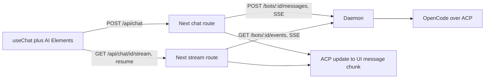

# Phase 3.1: web chat on the AI SDK and AI Elements stack

## Progress

Branch: `cursor/phase-3-1-web-chat-25ac`.

- [x] Pull latest `main` and create the branch.
- [x] Store the person's message, images included, as `user_message_chunk` updates. Only messages a person sends are stored. The opening prompt and schedule prompts are not, because `apps/daemon/tests/scheduler.test.ts` checks that a schedule's prompt stays out of the transcript. How schedules appear in a thread is left to 3.2.
- [x] Add `GET /bots/:id/events?from=N`. It replays stored updates from `N`, defaulting to the running turn's `replyFrom`. If the turn is still running, it then follows it live. It ends with `done` or `error`. With nothing to replay and no turn running, it answers `204`. A running turn's `TurnState` is now `{ status: "running", replyFrom }`, the index of its first reply update after the person's message. Tests are in `apps/daemon/tests/api.test.ts`.
- [ ] Switch shadcn to a Radix style, then install the AI SDK and the AI Elements components, which bring Streamdown.
- [ ] Write the converter from ACP updates to AI SDK messages, for live updates and stored transcripts, with unit tests.
- [ ] Add the `POST /api/chat` and `GET /api/chat/[id]/stream` routes that call the daemon.
- [ ] Build the chat page: default bot, transcript loading, `useChat` with resume, image attachments.
- [ ] Add Playwright tests against a fake agent (streaming, an attachment, a reload mid-turn), one live test, and the CI wiring.
- [ ] Update `PLAN.md` and `AGENTS.md`, and write `docs/phase-3-1.md`.
- [ ] At the end, send screenshots and a screen recording of the working chat.

### Notes for whoever continues

- **Avoiding a doubled reply on reload.** When a turn is running, the page should build its messages from `updates.slice(0, turn.replyFrom)`. That includes the person's message and leaves out the partial reply. Call `useChat` with `resume: true` only when the turn is running, and pass `from=replyFrom` to the stream route through `prepareReconnectToStreamRequest`. The resume stream then replays the reply from its first update as a new assistant message, so nothing appears twice.
- **The live POST stream never sends user chunks.** They're only stored. The converter only sees them when it reads a stored transcript.
- **Node version.** The repo wants Node 24 and CI uses 24. The VM had Node 22, and the daemon tests passed on it.

## Decisions

- Same stack as [vercel/chatbot](https://github.com/vercel/chatbot): AI SDK v7 (`ai` and `@ai-sdk/react`), AI Elements components copied in through their CLI, and Streamdown. We don't fork the template, and we leave out its auth, database, Redis and artifacts.
- The connection is HTTP with server-sent events, not a websocket. The browser calls Next.js route handlers, and they call the local daemon. The websocket decision moves to Phase 4.3, where the relay needs long-lived connections.
- The daemon keeps sending raw ACP `session/update` notifications. One converter in the web app turns them into AI SDK message stream parts.
- shadcn switches from Base UI (`base-nova`) to a Radix style, because AI Elements is built on Radix. Only `button.tsx` needs regenerating.
- One default bot, created or reused when the page loads. Choosing between bots is Phase 3.2.
- Image attachments only, within the daemon's existing limits: png, jpeg, gif or webp; at most 4 per message; at most 5 MB each.
- Reconnecting mid-turn is in scope. It needs no Redis, because the daemon already stores every update.
- Prefer existing, maintained components over writing our own, and customise them only lightly.

## Data flow

## Daemon changes (`apps/daemon/src/api.ts`)

- **Store the person's own message.** Store it, images included, as `user_message_chunk` updates before the turn starts, so a reload shows the whole conversation. OpenCode doesn't echo the user's message during a prompt, and a `session/load` replay arrives before the turn's listener is attached, so nothing is stored twice.
- **Follow a running turn.** Add `GET /bots/:id/events`. It replays the turn's stored updates, then streams new ones live using the existing `TurnEvent` format, and ends with `done` or `error`. With nothing to replay and no turn running, it answers `204`, the same as the template's resume route.
- New types go in `packages/shared/src/index.ts`.
- Tests in `apps/daemon/tests/api.test.ts`: a client that joins mid-turn gets the full reply, and a stored user message comes back in `GET /bots/:id`.

## Web app (`apps/web`)

- Switch `apps/web/components.json` to a Radix style and regenerate `button`.
- Install `ai` and `@ai-sdk/react`. Add AI Elements with the CLI: `conversation`, `message`, `prompt-input` (attachments included), `tool`, `reasoning` and `shimmer`. That brings in `streamdown` and `use-stick-to-bottom`. Customise them only where our data differs.
- **Converter** in `src/lib/`: turns ACP updates into AI SDK stream parts, and stored transcripts into the AI SDK message list.
  - message chunks become text
  - thought chunks become reasoning
  - `tool_call` and `tool_call_update` become dynamic tool parts with their input, output and error states
  - the person's message, with any images, becomes a user message with file parts
  - `done` finishes the message, and `error` becomes an error part
  - The switch over update kinds is exhaustive, with a `never` check.
- **Routes**, following the template's shape:
  - `POST /api/chat`: takes the last user message, turns file parts into `{ mimeType, data }` images, calls the daemon, and returns `createUIMessageStreamResponse`.
  - `GET /api/chat/[id]/stream`: proxies `/bots/:id/events` through the converter, or returns `204` when there's nothing to replay.
  - The daemon URL comes from the `COMPANION_DAEMON_URL` environment variable.
- **Page** (`apps/web/src/app/page.tsx`): a server component makes sure the default bot exists and loads its transcript. A client chat component uses `useChat` with AI Elements. A second message while a turn is running is blocked in the UI, because the daemon returns `409`.

## Tests

- **Unit (Vitest):** run the converter against the recorded hello fixture (`apps/daemon/fixtures/opencode-hello.json`), covering text, reasoning, tool calls, the person's images and errors.
- **End-to-end (Playwright, in CI):** a test script starts the daemon with a fake engine, using the scripted `Engine` pattern from `apps/daemon/tests/api.test.ts`, and starts `next start`. The test:
  1. sends a message and sees streamed markdown and a tool call
  2. attaches an image, sees it in the person's message, and checks that the daemon received it
  3. reloads the page mid-turn, then sees the turn continue and finish
- **Live:** one Playwright test against real OpenCode on Sarvam, gated by `COMPANION_LIVE=1`, the same way as the existing `apps/daemon/tests/*.live.test.ts`. It reuses `requireOpencode` from `apps/daemon/tests/helpers.ts`.
- Add Playwright to the root `check` and CI, next to the current smoke test. Run typecheck, lint and all tests before the work counts as done.

## Docs

- `PLAN.md`: change 3.1 from "websocket" to "server-sent events through Next.js route handlers", and note in 4.3 that the websocket decision moves there.
- `AGENTS.md`: add a rule to prefer existing, maintained components and libraries (AI Elements, shadcn, AI SDK) over writing our own, and to customise them only lightly.
- `docs/phase-3-1.md`: a short explainer of what was built, and why it uses the converter and server-sent events.
